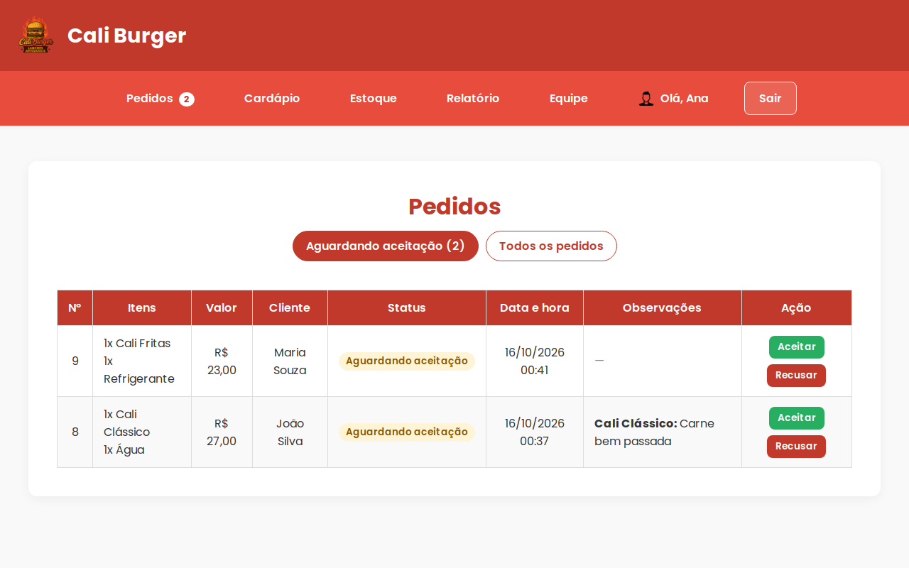
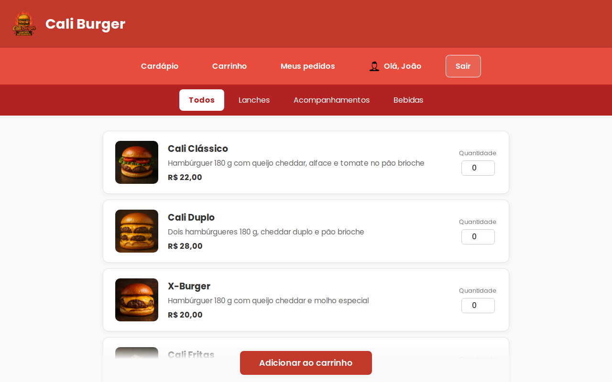
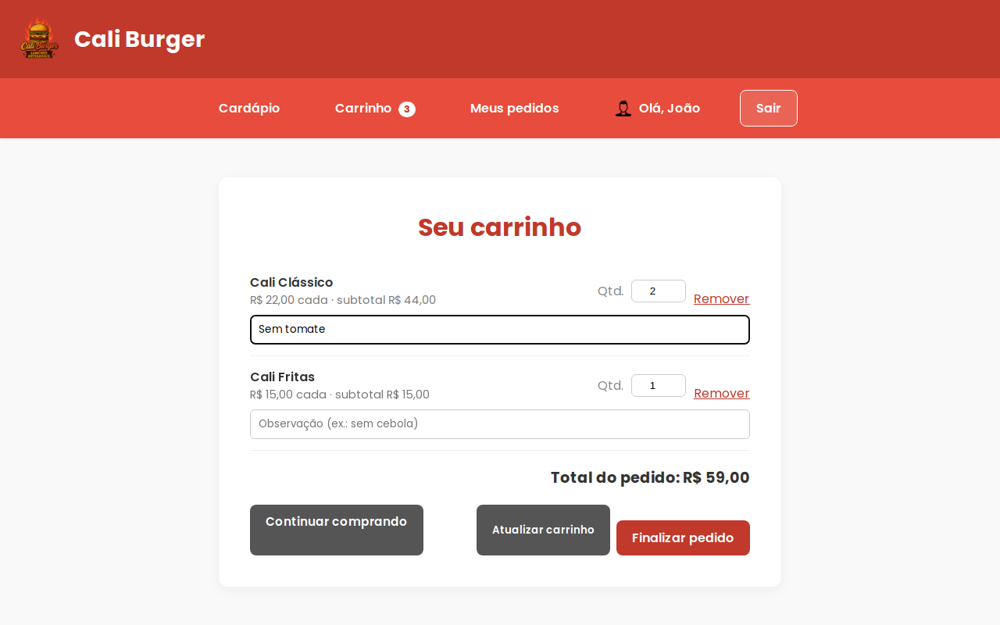
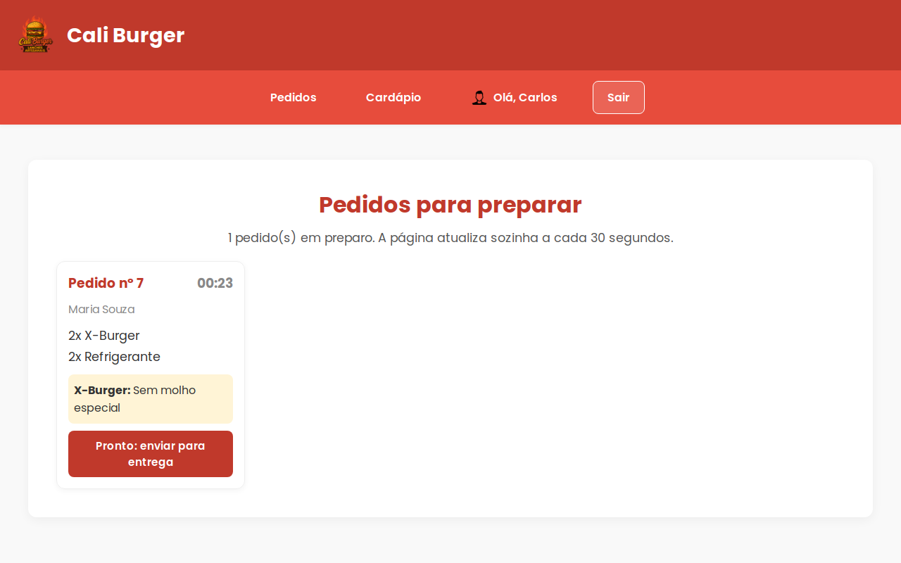
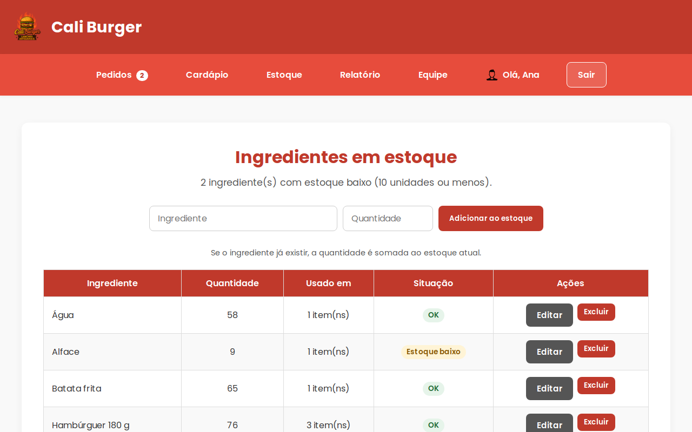
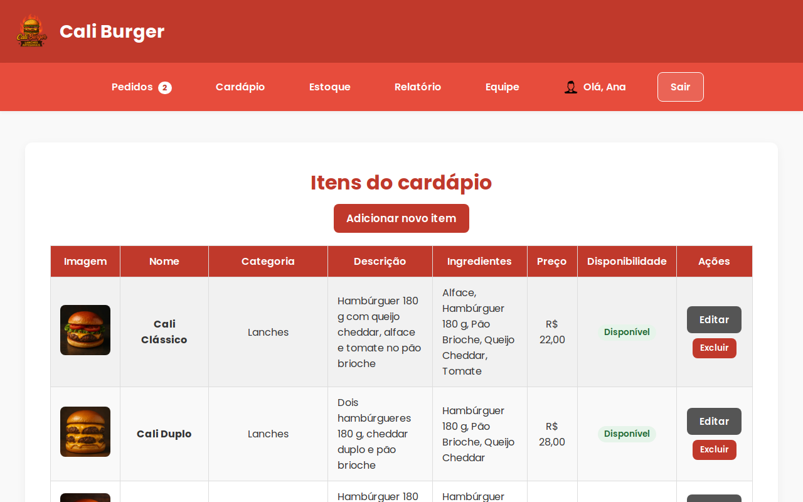
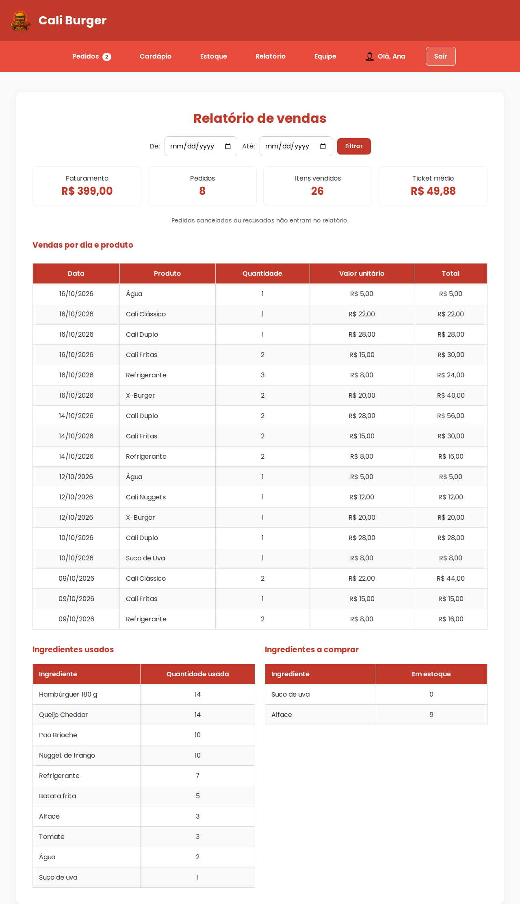
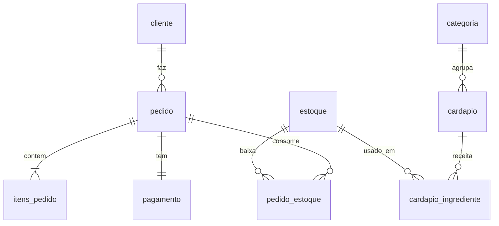

# 🍔 Cali Burger

[](https://github.com/SPTulio/cali-burger/actions/workflows/testes.yml)


Sistema web de pedidos para uma hamburgueria fictícia, a **Cali Burger**: o cliente monta o pedido pelo cardápio e paga via PIX, o balconista aceita, a cozinha prepara e o estoque de ingredientes é atualizado automaticamente.

Projeto acadêmico desenvolvido em equipe com PHP e MySQL, sem frameworks.



## Funcionalidades

O sistema tem três perfis, cada um com sua área e seu login:

| Perfil | O que faz |
| --- | --- |
| **Cliente** | Cria a conta, navega pelo cardápio por categoria, monta o carrinho com observações (ex.: "sem tomate"), paga via PIX e acompanha o status dos pedidos |
| **Balconista / dono** | Aceita ou recusa pedidos; gerencia cardápio (com fotos e receitas), estoque e equipe; vê o relatório de vendas |
| **Cozinheiro** | Vê a fila de pedidos em preparo (atualizada automaticamente) e envia para entrega |

**Fluxo do pedido:** `Aguardando aceitação → Em preparação → A caminho → Concluído`. O pedido também pode ser cancelado pelo cliente enquanto aguarda, ou recusado pelo balconista.

**Estoque integrado ao cardápio:** cada item tem uma receita (ex.: 1 pão, 1 hambúrguer, 1 cheddar). Ao confirmar um pedido, os ingredientes são descontados; se o pedido for cancelado ou recusado, eles voltam para o estoque. Itens sem ingredientes suficientes aparecem como "Esgotado".

<table>
  <tr>
    <td></td>
    <td></td>
  </tr>
  <tr>
    <td></td>
    <td></td>
  </tr>
  <tr>
    <td></td>
    <td></td>
  </tr>
</table>

## Como executar

### Com Docker (recomendado)

Pré-requisito: [Docker](https://docs.docker.com/get-docker/) com Docker Compose.

```bash
git clone https://github.com/SPTulio/cali-burger.git
cd cali-burger
cp .env.example .env
docker compose up -d --build
```

Acesse **http://localhost:8080**. O banco já vem com a estrutura e os dados de exemplo.

### Com XAMPP

1. Copie a pasta do projeto para `htdocs`.
2. No phpMyAdmin, importe `database/01_schema.sql` e depois `database/02_dados_exemplo.sql`.
3. Acesse `http://localhost/cali-burger/public/`.

A conexão padrão é `localhost`, usuário `root` e sem senha (o padrão do XAMPP). Para mudar, defina as variáveis `DB_HOST`, `DB_USUARIO`, `DB_SENHA` e `DB_NOME` ou edite `app/config.php`.

### Contas de demonstração

Todas usam a senha **123456**:

| Perfil | Login |
| --- | --- |
| Cliente | usuário `joao` (ou `maria`) |
| Balconista / dono | CPF `352.658.110-01` |
| Cozinheiro | CPF `211.996.250-27` |

Os CPFs são fictícios e servem só para passar na validação.

## Arquitetura

```text
cali-burger/
├── public/              # única pasta acessível pelo navegador
│   ├── *.php            # páginas (uma por tela)
│   ├── css/  js/  imagens/
├── app/                 # código compartilhado, fora do alcance do navegador
│   ├── bootstrap.php    # carregado por todas as páginas
│   ├── config.php       # configuração por variáveis de ambiente
│   ├── db.php           # conexão e consultas parametrizadas
│   ├── auth.php         # login, perfis e senhas
│   ├── csrf.php         # proteção de formulários
│   ├── pedidos.php      # regras dos pedidos (criação, status, estoque)
│   ├── cardapio.php     # disponibilidade, receitas e upload de imagens
│   ├── funcionarios.php # cadastro de balconistas e cozinheiros
│   ├── layout.php       # cabeçalho e rodapé das páginas
│   └── partials/        # menus e componentes reutilizados
├── database/            # estrutura do banco e dados de exemplo
├── tests/               # testes de ponta a ponta e capturas de tela
├── docker/  Dockerfile  docker-compose.yml
└── .github/workflows/   # integração contínua
```

As regras de negócio ficam centralizadas em `app/`. Por exemplo, `ACOES_PEDIDO` em `app/pedidos.php` define quem pode mudar um pedido de um status para outro. O servidor confere essas regras a cada requisição, então esconder um botão na tela não é a única proteção.

### Banco de dados



Além das tabelas acima, `balconista_dono` e `cozinheiro` guardam os funcionários. O banco também protege a consistência dos dados:
- **Chaves estrangeiras:** excluir um item do cardápio apaga sua receita, mas mantém o histórico de pedidos.
- **Restrições `CHECK`:** o estoque nunca fica negativo e todo preço é maior que zero.

## Segurança

- **SQL injection:** todas as consultas usam *prepared statements*.
- **XSS:** todo conteúdo digitado pelo usuário é escapado ao ser exibido (função `e()`).
- **CSRF:** todo formulário que altera dados leva um token secreto da sessão.
- **Senhas:** são guardadas com `password_hash` (bcrypt). Senhas antigas em texto puro são convertidas no primeiro login.
- **Controle de acesso por perfil:** cada página exige o perfil certo. O cliente só vê e altera os próprios pedidos e dados.
- **Sessão:** o id da sessão é renovado no login, o cookie é `HttpOnly` e `SameSite` e há limite de tentativas de login por sessão.
- **Upload de imagens:** o sistema confere o conteúdo real do arquivo (PNG, JPG ou WebP, até 2 MB) e salva com nome aleatório. A pasta de imagens não executa PHP.
- **Pedidos:** o pedido é criado numa transação com as linhas do estoque travadas, então dois pedidos simultâneos não usam o mesmo ingrediente.

## Testes

A pasta `tests/` tem testes de ponta a ponta em Python (pytest). Eles usam o sistema rodando no Docker: fazem as requisições como um navegador e conferem o resultado direto no banco. Os 24 testes cobrem:

- o fluxo completo do pedido, do carrinho até a entrega, com a baixa exata no estoque;
- a devolução ao estoque em pedidos recusados, e que um pedido sem estoque não é criado;
- o controle de acesso: um perfil não acessa a área de outro, e um cliente não altera pedidos ou dados de outro cliente;
- os ataques de SQL injection, XSS, CSRF e upload de arquivo malicioso;
- as senhas antigas, os funcionários novos, a troca de senha e o bloqueio por tentativas;
- o relatório (sem pedidos cancelados) e que todas as páginas abrem sem avisos do PHP.

```bash
docker compose up -d --build
pip install -r tests/requirements.txt
pytest tests
```

A cada push e pull request, o **GitHub Actions** confere a sintaxe do PHP, sobe o sistema no Docker, roda os testes e gera as capturas de tela deste README com o Playwright.

## Equipe

- Adnan Charif — [@AdnanCharif](https://github.com/AdnanCharif)
- Henrique Szlachta — [@HenriqueSzlachta](https://github.com/HenriqueSzlachta)
- Lucas Kumagae — [@lucaskumagae](https://github.com/lucaskumagae)
- Sérgio Pizzatto Tulio — [@SPTulio](https://github.com/SPTulio)

O histórico de commits da versão original foi preservado. O repositório inicial do grupo é o [lucaskumagae/caliburger](https://github.com/lucaskumagae/caliburger).
